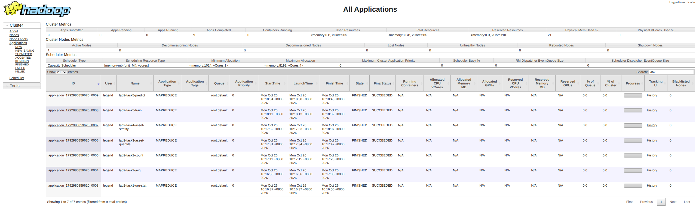

# 实验2：基于 MapReduce 的用户信贷数据分析

## 一、实验概述

本实验基于 Hadoop MapReduce 分布式计算框架，对银行脱敏客户信贷数据进行分析与建模。数据分为 `train.csv`（约 28 万用户，含标签 `bad_good`）和 `test.csv`（仅含特征，无标签），筛选后共 15 个字段。

| 列名 | 类型 | 含义 |
|:---|:---|:---|
| CUST_ID | bigint | 客户唯一标识 ID |
| OPEN_ORG_NUM | bigint | 开户机构编号 |
| bad_good | bigint | 客户好坏标签（0/1） |
| CUST_SAVING_AMT ~ CUST_METAL_AMT | double | 存款、理财、私人理财、基金、国债、银保通、贵金属 7 类资产 |
| CUST_ASSET_AMT | double | 资产总额 |
| CUST_DEBT_AMT | double | 负债总额 |
| G_OS_PRCP_SUM | double | 贷款账户月余额 |
| LOAN_FLAG / CRED_FLAG | string | 个贷标识 / 持有基金标志 |

实验共 5 个任务：任务 1~4 为数据分析（仅用 `train.csv`），任务 5 为机器学习预测（用 `train.csv` + `test.csv`）。

## 二、设计思路

各任务分别实现为独立的 Driver 类，共享 [Csv.java](src/main/java/lab2/Csv.java) 中的 CSV 解析辅助方法（缺失值/非法值统一按 0 处理，表头通过 `CUST_ID` 识别）。

### 任务1：各开户机构客户数量及资产统计（Task1）

- **Mapper**：逐行解析 `train.csv`，以 `OPEN_ORG_NUM` 为 key，value 组合为 `1 \t 资产 \t 负债 \t 是否逾期`。
- **Reducer**：对每个机构累加客户数、总资产、总负债、逾期客户数（`bad_good == 1`）。
- **输出**：`机构编号 \t 客户数量,总资产,总负债,个贷逾期客户数`（金额保留两位小数）。

### 任务2：平均值分析（Task2）

两阶段流水线：

- **Job A（map-only，单 reducer）**：读取任务1输出，计算每个机构的平均资产 `总资产 / 客户数量`，写入中间目录 `task2_avg`。
- **Job B**：通过 **DistributedCache**（`addCacheFile`）把平均值表分发到各 Mapper，在 `setup()` 中加载为 `Map<机构, 平均资产>`；Mapper 遍历 `train.csv`，比较每个客户资产与其机构平均值（`>=` 归入"高于"），Reducer 统计各机构高于/低于数量。

### 任务3：客户总资产四分位数（Task3）

- **利用框架内置排序**：Map 以 `CUST_ASSET_AMT` 为 key 输出，经 Shuffle 排序后进入单个 Reducer（`setNumReduceTasks(1)`），获得全局升序的资产序列。
- **线性插值**：`quantile(sorted, p)` 中 `pos = p * (n - 1)`，等价于 numpy 默认的 `linear` 插值，计算 Q25/Q50/Q75。
- **输出单行**：`Q25:<值> \t Q50:<值> \t Q75:<值>`。

### 任务4：客户资产分层与资产结构统计（Task4）

- **阈值注入**：Driver 先从任务3输出读取 Q25/Q50/Q75，通过 `Configuration.setDouble` 注入作业，Mapper 在 `setup()` 中读取。
- **分层**：按资产与四分位数的关系将客户分为 `低资产 / 中等资产 / 较高资产 / 高资产` 四层（tier 0~3）。
- **聚合**：Mapper 对每层输出 7 类资产的金额（key = 层级，value = `类型索引 \t 金额`），Reducer 汇总后计算每类资产占比。
- **排序**：Reducer 内先按层级升序（单 reducer 保证顺序集中），层内按占比降序排序后输出。

### 任务5：客户信贷风险预测（高斯朴素贝叶斯，Task5）

- **训练 Job**：TrainMapper 发射类别先验频度（key=`C\tlabel`）与每类每特征的 `1\tx\tx²`（key=`F\tlabel\t特征索引`）；TrainReducer 汇总得到每类先验、均值、方差，输出紧凑模型文件（单 reducer）。
- **预测 Job（map-only）**：模型经 DistributedCache 分发，PredictMapper 在 `setup()` 中加载模型，对 `test.csv` 每个客户计算两类的对数后验概率，取最大值作为预测标签。
- **方差正则化**：针对训练集中某类下恒定特征（方差≈0，如坏样本的 `G_OS_PRCP_SUM` 全为 0）会被高斯分布过度加权的问题，在 `setup()` 中给每个特征方差加上"该特征全局方差（组内+组间）的 1%"作为加性平滑项，避免单一零方差特征主导预测。

## 三、运行方法

### 1. 编译打包

```bash
cd Lab2
mvn clean package -DskipTests
# 产物：target/lab2-1.0.jar
```

### 2. 准备 HDFS 输入

```bash
hadoop fs -mkdir -p /user/$USER/lab2
hadoop fs -put train.csv test.csv /user/$USER/lab2/
```

### 3. 依次运行各任务

```bash
JAR=target/lab2-1.0.jar
TRAIN=/user/$USER/lab2/train.csv
TEST=/user/$USER/lab2/test.csv

hadoop jar $JAR lab2.Task1 $TRAIN /user/$USER/lab2/task1
hadoop jar $JAR lab2.Task2 /user/$USER/lab2/task1 $TRAIN /user/$USER/lab2/task2
hadoop jar $JAR lab2.Task3 $TRAIN /user/$USER/lab2/task3
hadoop jar $JAR lab2.Task4 $TRAIN /user/$USER/lab2/task3 /user/$USER/lab2/task4
hadoop jar $JAR lab2.Task5 $TRAIN $TEST /user/$USER/lab2/task5_model /user/$USER/lab2/task5
```

> 任务4 依赖任务3输出，任务5 依赖 `train.csv` 与 `test.csv`；所有输出目录必须不存在，可先 `hadoop fs -rm -r` 清理。

### 4. 一键运行脚本

也可直接使用本目录下的 [run.sh](run.sh) 一键完成打包、上传、全部任务运行与结果下载。

## 四、运行结果

### 任务1（`output/task1/part-r-00000`，共 687 个机构，节选）

```
1001	1254,184485852.19,112193577.37,32
1002	793,85762009.43,28727466.60,5
1003	887,116772867.93,23132764.24,9
...
```

机构 `1001`：1254 个客户，总资产 184485852.19，总负债 112193577.37，逾期客户数 32（即 `bad_good==1` 的客户数，经 `awk` 校验）。

### 任务2（`output/task2/part-r-00000`，共 687 个机构，节选）

```
1001	232,1022
1002	106,687
1003	144,743
...
```

机构 `1001` 结果 `232,1022` 与示例一致。

### 任务3（`output/task3/part-r-00000`，完整）

```
Q25:1127.35	Q50:6501.38	Q75:49173.11
```

经 Python（numpy 线性插值）交叉验证一致。

### 任务4（`output/task4/part-r-00000`，共 28 行 = 4 层 × 7 类，完整）

```
低资产	存款	0.9963
低资产	基金	0.0027
低资产	贵金属	0.0009
低资产	银保通	0.0001
低资产	国债	0.0000
低资产	理财	0.0000
低资产	私人理财	0.0000
中等资产	存款	0.9858
中等资产	基金	0.0102
...
高资产	存款	0.5602
高资产	理财	0.2949
高资产	私人理财	0.1086
高资产	基金	0.0265
高资产	国债	0.0083
高资产	银保通	0.0013
高资产	贵金属	0.0003
```

其中 `中等资产 → 存款 → 0.9858` 与示例一致。可见：低/中等资产客户以存款为主（占比 > 98%），高资产客户资产配置显著多元化（理财+私人理财占比约 40%）。

### 任务5（`output/task5/part-m-00000`，共 189766 个测试客户，节选）

```
1000000239	0
1000003260	0
1000003414	0
1000007147	1
...
```

预测分布：**预测为 0（好客户）184759 个，预测为 1（坏客户）5007 个**，坏客户比例约 2.6%，与训练集先验（坏客户约 1.7%）基本一致，模型无退化。模型核心目标为掌握 MapReduce 分布式预测流程，分数不作为重点。

## 五、可能的改进之处

1. **去重/局部预聚合**：任务1 中每个客户产生 1 条、任务4 中每个客户产生 7 条中间记录，可添加 Combiner 在 Map 端先局部求和，显著减少 shuffle 数据量。
2. **任务3 单 Reducer 内存风险**：四分位数计算依赖单 reducer 把全部资产加载进内存。数据量极大时可能 OOM，可改用近似分位数（如 t-digest）或多 reducer + 分桶汇总的方式。
3. **任务4 依赖本地读文件**：当前 Driver 用 `FileSystem.open` 读取任务3输出解析四分位数，可用 DistributedCache 替代，使依赖关系在任务调度层面更规范。
4. **模型扩展性**：任务5 目前为单 reducer 训练、内存加载模型。可扩展到多类别、加入特征选择/标准化；朴素贝叶斯假设特征独立，可尝试引入特征相关性处理或改用其他分类器。
5. **参数化与配置化**：特征索引、机构字段、输出格式等目前硬编码，可外置到配置文件或作业参数，便于复用。

## 六、运行成功截图

作业运行成功的 YARN ResourceManager Web 页面截图（7 个 `lab2-*` 作业均为 SUCCEEDED）：


